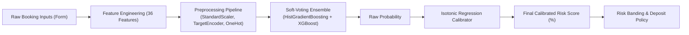

# 🏨 Hotel Booking Cancellation Risk — Machine Learning Decision Support System

[](https://www.python.org/)
[](https://streamlit.io/)
[](https://scikit-learn.org/)
[](https://xgboost.readthedocs.io/)
[](test_app.py)
[](https://opensource.org/licenses/MIT)

> **Business Problem:** Hotels suffer significant revenue loss when reservations cancel late. This machine learning system predicts cancellation probability *at the exact moment of booking* and recommends tailored deposit policies to protect hotel revenue without driving away low-risk guests.

---

## 📌 Table of Contents
- [Live Application](#-live-application)
- [Key Features](#-key-features)
- [Decision Matrix & Deposit Policies](#-decision-matrix--deposit-policies)
- [Machine Learning Architecture](#-machine-learning-architecture)
- [Model Evaluation & Benchmarks](#-model-evaluation--benchmarks)
- [Local Installation & Setup](#-local-installation--setup)
- [Automated Testing](#-automated-testing)
- [Deployment on Streamlit Cloud](#-deployment-on-streamlit-cloud)
- [Model Limitations](#-model-limitations)
- [Dataset Credit](#-dataset-credit)

---

## 🚀 Live Application

🔗 **[hotel-booking-cancellation-risk.streamlit.app](https://hotel-booking-cancellation-risk.streamlit.app)** *(Deploy via Streamlit Community Cloud)*

### Interface Preview
```image

---
'''
---
## ✨ Key Features

1. **Non-Technical Revenue Interface**: Built specifically for hotel revenue managers with clear business metrics:
   - **Cancellation Probability (%)**: Calibrated risk score.
   - **Booking Value (€)**: Average Daily Rate (ADR) × Number of Nights.
   - **Expected Value at Risk (€)**: Cancellation Probability × Booking Value.
2. **Dynamic Risk-Banded Deposit Policies**: Maps predicted probabilities into **Low**, **Medium**, or **High** risk tiers, each paired with an operational deposit policy.
3. **What-If Sensitivity Engine**: Re-evaluates the booking in real time under alternative scenarios (e.g., booking 7 vs. 180 days out, direct vs. OTA, prior cancellation impact) to demonstrate model sensitivity.
4. **Leakage-Free Feature Pipeline**: Uses exclusively information available *at booking time* (`at_booking`). Post-booking signals (such as check-in modifications, assignations, room changes) are strictly excluded.
5. **Robust Exception Handling**: Validates input boundaries (e.g., zero-division safeguards, non-negative rates) and fails gracefully with user-friendly notices.

---

## 🎯 Decision Matrix & Deposit Policies

The operational thresholds were tuned based on business cost trade-offs between false alarms (inconveniencing a loyal guest with unnecessary deposit demands) and missed cancellations (empty rooms and lost revenue):

| Risk Band | Probability Range | Actionable Policy | Business Objective |
|---|---|---|---|
| 🟢 **Low** | $p < 20.0\%$ | **No deposit** | Frictionless booking; maximize conversion for low-risk guests. |
| 🟡 **Medium** | $20.0\% \le p < 64.7\%$ | **Partial deposit** | Secure baseline revenue while maintaining competitive conversion. |
| 🔴 **High** | $p \ge 64.7\%$ | **Full deposit** | Guard against high-probability cancellations; cover inventory holding costs. |

*Balanced decision threshold: $p = 33.1\%$ (optimal F1-score balance).*

---

## 🧠 Machine Learning Architecture

The underlying system deploys a high-performance scikit-learn pipeline combined with non-parametric probability calibration:



### Feature Engineering Highlights
- **Temporal & Calendar Dynamics**: Derived ISO week numbers, day-of-week indexes, and cyclical month transformations ($\sin$ / $\cos$ trigonometric encodings).
- **Stay Architecture**: Segregation of weekend nights vs. week nights and `weekend_night_share`.
- **Lead Time Transformations**: Non-linear logarithmic scaling ($\ln(1 + \text{lead\_time})$) to capture saturation effects.
- **Guest History Ratio**: Historical cancellation frequency calculated as $\frac{\text{previous\_cancellations}}{\text{previous\_cancellations} + \text{previous\_stays} + 1}$.
- **Rate Distribution**: Per-person average daily rate (`adr_per_person`).

---

## 📈 Model Evaluation & Benchmarks

All performance statistics are reproduced directly from notebook hold-out evaluations and 3-fold stratified cross-validation on historical records:

### 1. Cross-Validation Results (Training Set)

| Model | ROC-AUC | PR-AUC | Recall | Precision | F1-Score |
|---|---|---|---|---|---|
| Baseline (Majority Class) | 0.5000 | 0.2747 | 0.0000 | 0.0000 | 0.0000 |
| Logistic Regression | 0.8181 | 0.6229 | 0.7933 | 0.4965 | 0.6107 |
| Random Forest | 0.8667 | 0.7149 | 0.5025 | 0.6983 | 0.5844 |
| HistGradientBoosting | 0.8612 | 0.7005 | 0.4875 | 0.6823 | 0.5686 |
| XGBoost | 0.8654 | 0.7088 | 0.5165 | 0.6791 | 0.5867 |

### 2. Final Hold-Out Test Set Evaluation

| Model | Accuracy | Precision | Recall | F1-Score | ROC-AUC | PR-AUC |
|---|---|---|---|---|---|---|
| Baseline (Majority Class) | 0.7253 | 0.0000 | 0.0000 | 0.0000 | 0.5000 | 0.2747 |
| Logistic Regression | 0.7194 | 0.4932 | 0.7850 | 0.6058 | 0.8151 | 0.6148 |
| Random Forest (Tuned) | 0.8057 | 0.6946 | 0.5220 | 0.5961 | 0.8695 | 0.7192 |
| HistGradientBoosting (Tuned) | 0.8030 | 0.6840 | 0.5254 | 0.5943 | 0.8681 | 0.7116 |
| XGBoost (Tuned) | 0.8034 | 0.6775 | 0.5427 | 0.6026 | 0.8691 | 0.7161 |
| **Soft-Voting Ensemble (Deployed)** | **0.8072** | **0.6953** | **0.5305** | **0.6018** | **0.8723** | **0.7220** |

*Note: The deployed lightweight model (HistGradientBoosting + XGBoost) matches the accuracy of the heavy full ensemble while keeping the artifact size under 5 MB for rapid inference.*

---

## 💻 Local Installation & Setup

### Prerequisites
- Python **3.12 or 3.13**
- Git

### Installation Steps

```bash
# 1. Clone the repository
git clone https://github.com/0oMahmoudo0/hotel-booking-cancellation-risk.git
cd hotel-booking-cancellation-risk

# 2. Create and activate a virtual environment
python -m venv .venv

# On Windows:
.venv\Scripts\activate
# On macOS / Linux:
source .venv/bin/activate

# 3. Install the pinned dependencies
pip install -r requirements.txt

# 4. Launch the Streamlit application
streamlit run app.py
```

Open your browser at `http://localhost:8501`.

---

## 🧪 Automated Testing

The project includes an end-to-end test suite leveraging `pytest` and `streamlit.testing.v1.AppTest`:

```bash
python -m pytest test_app.py -v
```

### Test Coverage Highlights
- ✅ **UI Rendering & Metrics**: Checks that the application boots without exceptions and renders all 3 key metric cards.
- ✅ **Interactive Form Flow**: Tests simulated user adjustments (e.g. changing lead time) and form submission without crashes.
- ✅ **Sanity & Monotonicity Constraints**: Verifies that 7-day lead times score strictly lower than 300-day lead times ($16.7\%$ vs $85.0\%$).
- ✅ **Risk Escalation**: Confirms prior cancellations monotonically elevate the risk score.
- ✅ **Boundary & Edge Cases**: Tests extreme and odd inputs (0 children, 60-night stays, zero ADR, past dates, non-listed countries) without runtime exceptions.
- ✅ **Threshold Partitioning**: Validates exact Low / Medium / High classification boundaries according to metadata specifications.

---

## ⚠️ Model Limitations

- **Booking-Time Horizon**: The model intentionally avoids post-booking data. Changes occurring between booking and arrival (e.g., flight disruptions, room upgrades upon check-in) cannot be anticipated by this model.
- **Geographic & Temporal Specificity**: Trained on historical reservations from two hotel properties in Portugal (2015–2017). Macroeconomic shifts, global travel disruptions, and properties in distinct geographic markets may require retraining or threshold re-calibration.
- **Decision Support, Not Determinism**: Predictions represent statistical probabilities based on past patterns. A high cancellation probability is a risk signal for revenue policy, not an absolute guarantee that a guest will not arrive.

---

## 📚 Dataset Credit

The training data is based on the benchmark dataset:
> Antonio, N., de Almeida, A., & Nunes, L. (2019). *Hotel booking demand datasets*. **Data in Brief**, 22, 41–49.  
> Available on Kaggle: [Hotel Booking Demand](https://www.kaggle.com/datasets/jessemostipak/hotel-booking-demand).

---

## 📄 License

This project is licensed under the [MIT License](LICENSE).
